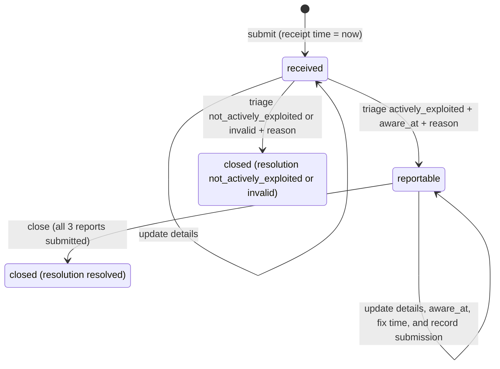

# Pod specification (Phase 2)

What every Pod K system must accept and return, and what counts as correct behavior. This
is the specification Teams 17 and 21 agreed on September 25, 2026 (Phase 2 report,
Sections 2 to 6), transcribed so it can be read and linked without the PDF. Nothing here
is new.

- **Interface contract:** [`openapi.yaml`](openapi.yaml). If this file and the contract
  disagree about an interface detail, the contract wins.
- **Shared test cases:** Model D examples with hand-calculated expected outputs, proposed in
  [pull request #8](https://github.com/team17-ece30861/pod-k-shared/pull/8) and waiting on
  Team 21's check.
- **Changes:** this specification and the contract change only by pull request, approved
  by both teams. If either one seems to disagree with the Phase 2 report, raise it with both
  teams before changing anything.

## Scope

**In scope:** ticket intake over HTTPS with a receipt time set by the server; triage as
reportable (actively exploited, with awareness time and reason supplied by a person) or
closed as not reportable; deadlines and live status for the early warning, notification,
and final report; report drafts with missing-field checks; recording reports submitted
outside the system; an append-only audit log per ticket; a draft user advisory.

**Out of scope:** submitting anything to ENISA or a CSIRT; severe incidents (Art. 14(3)-(4));
deciding whether exploitation is real or when awareness happened (people decide that);
each team's own intake channel (not part of the shared spec); vulnerability detection,
SBOM matching, deploying fixes.

**Limits:** one manufacturer per deployment, one product per ticket, at most 1,000
tickets, English JSON, all times UTC, EU member states only.

## Requirements

| ID | Requirement (short form) |
|---|---|
| REQ-01 | **Intake.** A valid ticket is stored in state `received` with a unique ID and receipt time = current system time. Returns 201 with the ticket. |
| REQ-02 | **Reportable.** While `received`, triage as actively exploited with an awareness time and reason moves it to `reportable` and starts deadlines from the awareness time. Awareness may be earlier than receipt but not later than now. |
| REQ-03 | **Not reportable.** While `received`, triage as not actively exploited or invalid, with a reason, closes it. No deadlines apply. |
| REQ-04 | **Deadlines.** Early warning = awareness + 24 h. Notification = awareness + 72 h. Once a fix time is recorded, final report = fix + 14 days, or awareness + 14 days if the fix came first. Exact elapsed UTC hours, no weekend, holiday, or DST adjustment. |
| REQ-05 | **Obligation status.** Each of the three reports has one status based on the current time: `not_applicable` (ticket not reportable), `awaiting_fix` (final report, no fix time), `pending` (not submitted, not yet due), `overdue` (not submitted, past due), `submitted` (on time), `submitted_late`. |
| REQ-06 | **Updates.** While not closed, details can be updated. Changing the awareness time needs a reason and is allowed only while `reportable`. Neither awareness nor fix time may be later than now. Any change to either recalculates deadlines immediately. |
| REQ-07 | **Drafts.** For early warning, notification, final report, and user advisory, return a draft built from ticket fields plus the list of missing required fields (Model C). |
| REQ-08 | **Submission recording.** While `reportable`, recording one of the three Article 14 reports succeeds only if no required fields are missing and the previous report (early warning, then notification, then final report) is already submitted. The report's content is then locked. |
| REQ-09 | **Closure.** While `reportable`, close only after all three reports are submitted. A closed ticket rejects every change but can still be read. |
| REQ-10 | **Listing.** List tickets, filterable by state and by report status, nearest unmet deadline first. |
| REQ-11 | **Audit log.** Every request that changes a ticket adds an entry: time, person, action, old and new values, reason. Entries are never edited or deleted, except by test reset. |
| REQ-12 | **Errors.** Invalid or not-allowed requests are rejected with the Section 5 status code and format, name the field at fault, and change nothing. Invalid input never causes a 5xx. |
| REQ-13 | **Time format.** Accept RFC 3339 with any UTC offset. Return every timestamp in UTC, to the second. |
| REQ-14 | **Auth and HTTPS.** HTTPS only. Every request except the health check needs a valid token. Every change names the person making it (`X-Actor`). |
| REQ-15 | **Reporter confidentiality.** Reporter name and contact appear only in the single-ticket response. Never in lists, drafts, advisories, logs, or error messages. |
| REQ-16 | **Test controls.** A reset that deletes all data, and a clock that stays fixed at a given time until changed. |
| REQ-17 | **Performance.** With up to 1,000 tickets stored, 95% of requests finish within 1 second, measured by the test client. |
| REQ-18 | **Persistence.** Tickets, reports, and audit logs survive a service restart. |

Not applicable: privacy beyond reporter details, availability beyond test windows,
scale past 1,000 tickets, accessibility and localization (no UI in the shared spec).

## Models

### Model A: ticket lifecycle (REQ-01, 02, 03, 06, 08, 09, 12)

Rejected, with no state change and no audit entry: any change to a closed ticket;
re-triage; close with reports outstanding; record submission or close while `received`;
triage with a missing or future awareness time; any invalid update.

### Model B: report status, one per report (REQ-04, 05, 06, 08)

Status is never stored. It is recalculated on every read from the stored awareness,
fix, and submission times and the current (possibly fixed) clock. Setting the test
clock backward can move an `overdue` report back to `pending`.

| Status | When |
|---|---|
| `not_applicable` | Ticket is not reportable (still `received`, or closed as not reportable). |
| `awaiting_fix` | Final report only, no fix time yet. |
| `pending` | Not submitted, current time ≤ due time. |
| `overdue` | Not submitted, current time > due time. |
| `submitted` | Submitted time ≤ due time. |
| `submitted_late` | Submitted time > due time. |

A submission with missing fields or out of order is rejected and the status is unchanged.

### Model C: required fields per draft (REQ-07, 08, 15)

R = required: listed in `missing_fields` when empty, and blocks recording a submission.
O = included if present. — = not included. Every draft also contains the ticket ID and
awareness time. The user advisory has no deadline and no submission; it is available
once a ticket is reportable.

| Ticket field | Early warning | Notification | Final report | User advisory | Basis |
|---|---|---|---|---|---|
| `product.manufacturer`, `product.name` | R | R | R | R | Art. 14(2)(b), 14(8) |
| `product.affected_versions` (at least one) | R | R | R | R | Art. 14(2)(b), 14(8) |
| `member_states` (at least one) | R | R | R | — | Art. 14(2)(a) |
| `vulnerability.cve_id` | — | O | O | O | — |
| `vulnerability.description` | — | R | R | R | Art. 14(2)(b), (c)(i); 14(8) |
| `exploit.description` | — | R | R | — | Art. 14(2)(b) |
| `mitigations.taken` | — | R | R | — | Art. 14(2)(b) |
| `mitigations.for_users` | — | R | R | R | Art. 14(2)(b); 14(8) |
| `sensitivity` (TLP 2.0) | — | R | R | — | Art. 14(2)(b) |
| `severity`, `impact` | — | — | R | O | Art. 14(2)(c)(i) |
| `malicious_actor` | — | — | O | — | Art. 14(2)(c)(ii) |
| `fix.available_at`, `fix.description` | — | — | R | O | Art. 14(2)(c)(iii) |
| `fix.fixed_versions` (at least one) | — | — | R | O | Art. 14(2)(c)(iii) |
| `reporter.name`, `reporter.contact` | never | never | never | never | REQ-15 |

### Model D: deadline examples, shared expected outputs (REQ-02, 04, 05, 06, 13)

Every implementation must return exactly these values.

| # | Scenario | Input | Expected output |
|---|---|---|---|
| E1 | Friday report, triaged Monday, awareness at receipt | Received 2026-10-02T17:00:00Z (Fri). Triaged at 2026-10-05T09:00:00Z with awareness 2026-10-02T17:00:00Z | Early warning due 2026-10-03T17:00:00Z (`overdue` at triage). Notification due 2026-10-05T17:00:00Z (`pending`) |
| E2 | Same report, awareness at Monday confirmation | Same as E1, awareness 2026-10-05T09:00:00Z | Early warning due 2026-10-06T09:00:00Z. Notification due 2026-10-08T09:00:00Z |
| E3 | Exploitation evidence arrives after the report | Received 2026-10-05T09:00:00Z, awareness 2026-10-07T14:30:00Z | Early warning due 2026-10-08T14:30:00Z. Notification due 2026-10-10T14:30:00Z |
| E4 | Fix after awareness | Awareness 2026-10-05T09:00:00Z, fix 2026-10-20T12:00:00Z | Final report due 2026-11-03T12:00:00Z (no DST shift) |
| E5 | Fix released before awareness | Awareness 2026-10-05T09:00:00Z, fix 2026-09-28T00:00:00Z | Final report due 2026-10-19T09:00:00Z (14 days from awareness) |
| E6 | Exact boundary | E2, early warning not submitted; clock at 2026-10-06T09:00:00Z, then 09:00:01Z | `pending` at the due time, `overdue` one second later |
| E7 | Time zone offset in input | Awareness sent as 2026-10-05T11:00:00+02:00 | Stored and returned as 2026-10-05T09:00:00Z |
| E8 | Awareness in the future (failure) | Clock 2026-10-05T09:00:00Z, awareness 2026-10-05T09:00:01Z | Rejected (422); ticket stays `received`; no deadlines |

Fixed assumptions so teams don't diverge: deadlines are exact UTC hours; all three
reports are always required (even though Art. 14(2)(b)-(c) lets one be skipped when the
information was already given); a fix released before awareness starts the 14-day clock
at awareness (E5); every notification field is required even though the regulation says
"as available", so incomplete reports are flagged instead of skipped.

## Acceptance criteria

Unless noted, every test first resets the service and fixes the clock. "Auto" means
another team can run it through the HTTP interface.

| ID | Covers | Setup and action | Expected | Method |
|---|---|---|---|---|
| AC-01 | REQ-01, 13 | Clock at 2026-10-02T17:00:00Z; submit two valid tickets | Both 201, state `received`, `received_at` 2026-10-02T17:00:00Z, different IDs | Auto |
| AC-02 | REQ-01, 12 | Submit with no title; unknown source; client-supplied receipt time; invalid JSON; body over 64 KB | 400 naming the bad field (413 for the large body); ticket count unchanged | Auto |
| AC-03 | REQ-02, 04 | Reproduce Model D E1 to E5 | Every due time and status matches to the second | Auto |
| AC-04 | REQ-02 | Triage actively exploited with no awareness time; future awareness (E8); no reason; triage an already reportable ticket | 400, 422, 400, 409; ticket unchanged each time | Auto |
| AC-05 | REQ-03, 09 | Triage as not actively exploited, then try to change the ticket | Closed, all reports `not_applicable`; changes 409; reads work | Auto |
| AC-06 | REQ-05 | Step the clock through E6; record one report before its due time and one after | `pending` at due time, `overdue` one second later; `submitted` and `submitted_late` as appropriate; final report `awaiting_fix` until a fix time is set | Auto |
| AC-07 | REQ-06 | Change awareness with and without a reason; set a future fix time; change awareness on a `received` ticket | Recalculated with an audit entry; 422; 422; 409 | Auto |
| AC-08 | REQ-07, 15 | Fill ticket fields one at a time; read all four drafts after each step | `missing_fields` matches Model C at every step; no reporter details in any draft | Auto |
| AC-09 | REQ-08 | Record notification before early warning; early warning with no member states; a valid early warning; the same again; final report with no fix time; then edit the product name | 409, 422, 200, 409, 409; the recorded early warning's content is unchanged after the edit | Auto |
| AC-10 | REQ-09 | Close with the final report outstanding; then record all three and close | 409, then closed with resolution `resolved` | Auto |
| AC-11 | REQ-10 | Four tickets: one received, one overdue, two pending with different due times. List with each filter | Exactly the expected tickets, nearest deadline first | Auto |
| AC-12 | REQ-11 | Scripted lifecycle with a known number of successful and failed requests; try to edit or delete the log | One entry per successful change, `seq` 1 to n with no gaps, matching actor and time; failures add nothing; edit or delete returns 405 | Auto |
| AC-13 | REQ-12 | At least 500 malformed requests generated from the OpenAPI file | No 5xx; every error in the Section 5 format; no data changes | Auto |
| AC-14 | REQ-13 | Reproduce E7; send `2026-10-05 09:00` and `2026-10-05T09:00:00.789Z` | E7 value returned; 400; stored as 2026-10-05T09:00:00Z | Auto |
| AC-15 | REQ-14 | Every endpoint with no token and a wrong token; a change without `X-Actor`; a request over plain HTTP | 401 everywhere except health; 400; plain HTTP refused or redirected with no data | Auto |
| AC-16 | REQ-15 | Set reporter contact to a unique string; call every read endpoint; trigger errors on that ticket | The string appears only in the single-ticket response | Auto |
| AC-17 | REQ-16 | Create tickets, reset, list; set the clock and read it twice 2 s apart; submit a ticket | Empty list; both reads identical; receipt time equals the set clock | Auto |
| AC-18 | REQ-17 | Load 1,000 tickets; send 200 mixed requests one at a time | p95 ≤ 1 s | Auto |
| AC-19 | REQ-18 | Ticket with a recorded report; restart the service; read it | Ticket, report, and audit log unchanged | Recorded demo by the owning team |

## Interface summary

The contract is [`openapi.yaml`](openapi.yaml). In short:

- Errors: 400 schema, 401 token, 404 unknown ticket or report type, 405 method not
  allowed, 409 not allowed in the current state, 413 body over 64 KB, 422 valid request
  that breaks a rule. When several apply: **401, 413, 404, 400, 409, 422**.
- Submit, triage, update, record submission, and close each add exactly one audit entry
  on success. Reads change nothing. A failed request changes nothing.
- Testing: each team publishes its base URL in the shared pod file and sends its token
  privately. Every test calls `POST /test/reset` then `PUT /test/clock`. Reset clears the
  whole deployment, so only one suite runs against a deployment at a time.
