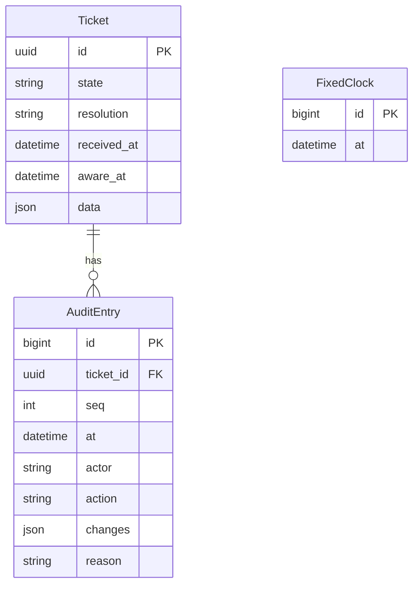
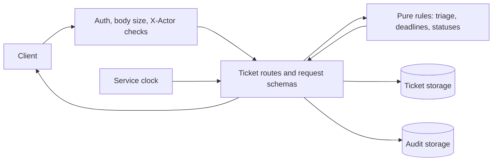

# Team 17 system documentation (as delivered in Phase 3)

*Published copy of Team 17's system documentation, refreshed at each Team 17 release.*

What Team 17's CRA reporting service does at the end of Phase 3: its models, interfaces,
functionality, validation, and known limitations. Last updated 2026-10-18.

The service is deployed on Google Cloud Run at https://team17-prod-7zneiwx4ba-uc.a.run.app.
The interface contract shared with Team 21 is [`openapi.yaml`](tester/openapi.yaml). How to
test it, and how it behaves where the contract is silent, is in [TESTING.md](TESTING.md). The
automated tester is in [tester/](tester/README.md).

## Functionality

Through the common HTTPS interface, a client can:

- **Submit a vulnerability report as a ticket** (REQ-01). The service assigns an opaque ID,
  sets state `received`, and stamps the receipt time from the service clock.
- **Triage it** (REQ-02, REQ-03): as actively exploited, with an awareness time and reason,
  which makes it `reportable` and starts the deadlines; or as not actively exploited or
  invalid, which closes it with that resolution.
- **See the Article 14 deadlines with live status** (REQ-04, REQ-05): early warning at
  awareness + 24 h, notification at + 72 h, and the final report 14 days after a fix (or
  after awareness, if the fix came first). Statuses (`not_applicable`, `awaiting_fix`,
  `pending`, `overdue`) are recalculated on every read from the service clock.
- **Update ticket details** (REQ-06), including the awareness time (reason required, only
  while `reportable`) and the fix time. Deadlines are recalculated immediately.
- **Read a ticket's audit log** (REQ-11). Every successful change adds one entry with time,
  actor, action, field changes, and reason. Failed requests add nothing.
- **List tickets**, nearest deadline first (REQ-10, without filters so far).
- **Use test controls** (REQ-16): reset all data, and fix or release the service clock.

All requests except `GET /health` need a bearer token, and changes need an `X-Actor` header
(REQ-14). Errors use problem details with the contract's status codes and precedence, and a
failed request changes nothing (REQ-12). Reporter details appear only in
`GET /tickets/{id}` (REQ-15).

## Interfaces

| Operation | Status | Notes |
| --- | --- | --- |
| `GET /health` | Delivered | Public. Doesn't check the database. |
| `POST /tickets` | Delivered | |
| `GET /tickets` | Partial | Ordered list. `state` and `obligation_status` filters are ignored until Phase 4. |
| `GET /tickets/{id}` | Delivered | The only response with reporter details. |
| `PATCH /tickets/{id}` | Delivered | Merges nested objects one level deep; `null` clears optional fields. |
| `POST /tickets/{id}/triage` | Delivered | |
| `GET /tickets/{id}/audit` | Delivered | Other methods return 405. |
| `POST /test/reset` | Delivered | Clears all tickets and audit entries; keeps a fixed clock. |
| `GET`, `PUT`, `DELETE /test/clock` | Delivered | |
| `GET /tickets/{id}/reports/{type}` | Not yet | Phase 4 (report drafts) |
| `POST /tickets/{id}/reports/{type}/submission` | Not yet | Phase 4 (submission recording) |
| `POST /tickets/{id}/close` | Not yet | Phase 4 (closing a reportable ticket) |

Where the contract is silent (error precedence details, timestamp variants, how
`errors[].field` is written, and so on), the service's behavior is listed in
[TESTING.md](TESTING.md#how-we-handle-gray-areas).

## Models

### Data

`Ticket` stores the state, resolution, receipt and awareness times, and the validated client
fields as JSON. `AuditEntry` stores each ticket's numbered log entries. `FixedClock` holds
the test clock, in the database so every worker sees the same time. Deadlines and statuses
are never stored; they're derived on every read.

### Ticket lifecycle (delivered part of Model A)

`received` to `reportable` (actively exploited), and `received` to `closed` (not actively
exploited or invalid). A closed ticket rejects every change with 409 and stays readable.
Closing a `reportable` ticket as `resolved` arrives in Phase 4.

### Request flow

Each changing request runs in one database transaction that's rolled back on any error.
Triage and updates lock the ticket row, so two competing triages give one success and one
409. The deadline and triage rules are pure functions in `core/domain/`, with no database
or clock access.

## Validation

**Acceptance criteria covered by the automated tester** ([tester/](tester/README.md), run over
HTTPS and inside our CI):

| Criterion | What's checked |
| --- | --- |
| AC-01 | Two tickets get unique IDs, state `received`, and the fixed receipt time. |
| AC-02 | Missing or invalid fields, invalid JSON, and an over-64-KB body are rejected; ticket count unchanged. |
| AC-03 | Model D E1 to E5 deadlines and statuses, exactly. |
| AC-04 | Missing or future awareness, missing reason, and re-triage are rejected; ticket unchanged. |
| AC-05 | Both non-reportable decisions close the ticket; changes return 409; reads work. |
| AC-14 | E7 offset handling, fractional-second truncation, malformed timestamps rejected. |
| AC-15 | 401 on every protected operation with no or a wrong token; 400 without `X-Actor`; plain HTTP redirected to HTTPS. |
| AC-17 | Reset empties the service; the clock stays fixed; receipt time follows it. |

Every response is also checked against `openapi.yaml`. The Model D E6 boundary (part of
AC-06) is checked too. Local integration tests add AC-07 (updates), audit privacy and
counts, rollback, and PostgreSQL row locking. The pod's shared Model D test file (E1 to E8)
is proposed in this repository (`tests/`) and waiting on Team 21's check.

**Recorded runs:**

| Run | Target | Result | When |
| --- | --- | --- | --- |
| Acceptance suite | Evaluation deployment (Cloud Run, Neon Postgres) | 55 passed, 0 failed, 0 skipped | 2026-10-18 00:51 to 00:52 UTC |
| Acceptance suite | Development deployment | 55 passed, 0 failed, 0 skipped | 2026-10-17 22:04 to 22:05 UTC |
| AC-07, by hand | Development deployment | All four cases passed, with failed requests leaving the ticket and audit log unchanged | 2026-10-18 about 02:00 UTC |
| REQ-18 restart check | Development deployment | A ticket and its audit log read back identically after a new revision replaced the running service | 2026-10-18 02:03 to 02:09 UTC |
| CI (every PR) | Linux, Python 3.12, PostgreSQL 18 | Full test suite, lint, migration and Django checks | Ongoing |

**GenAI corrections caught by testing:** a test setup that passed on SQLite but failed on
PostgreSQL in CI (truncating the audit table with deferred foreign-key triggers pending); a
PATCH bug where every update re-checked a stored fix time (found in review, fixed with
regression tests); and two testing-guide claims that held under the development server
but not on the deployed stack (corrected in TESTING.md).

## Known limitations

- **Phase 4 operations aren't built:** report drafts, submission recording (so no
  `submitted` or `submitted_late` statuses yet), closing a reportable ticket, and list
  filters.
- **Open questions with Team 21:** a non-reportable triage that includes `aware_at` is
  accepted and the time dropped (Q1); a future fix time is accepted at submission (Q7); the
  final-report clock should arguably start at a mitigating measure, not only a fix, per
  CRA Art. 14(2)(c) (Q8); early-warning required fields are stricter than CRA Art. 14(2)(a)
  (Q9).
- **Not yet cross-tested:** Team 21 hasn't run their suite against us, and the shared test
  file isn't cross-checked yet.
- **AC-07 isn't in the automated tester yet;** it's covered by local tests and was checked by
  hand on the development deployment.
- **Hosting:** the service scales to zero, so the first request after idle takes about 3 to 6
  s, plus about 1.5 s for the first database read. It runs as one instance handling two
  requests at a time. All clients share one database and test clock. A $10 spending cap
  would stop it until lifted by hand. `GET /health` doesn't check the database.
- **Deployed edge cases:** Google's front end rejects any `GET` that has a body before it
  reaches the service.
- **Deadlines use exact elapsed UTC hours,** with no weekend, holiday, or daylight-saving
  adjustment. That's deliberate and conservative.
- **Persistence** is shown by a restart check; the recorded AC-19 demonstration is planned
  for Phase 5.
