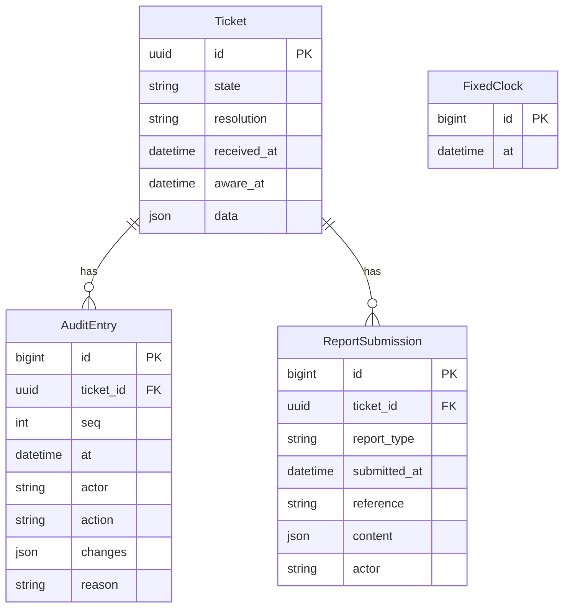

# Team 17 system documentation (as delivered)

*Published copy of Team 17's system documentation, refreshed at each Team 17 release.*

What Team 17's CRA reporting service does at the end of Phase 4: its models, interfaces,
functionality, validation, and known limitations. Last updated 2026-11-01 (US Eastern;
times in the tables below are UTC). The Phase 3 version is kept as a record in
[Team 17's repository](https://github.com/team17-ece30861/cra-service/blob/main/docs/phase3.md).

The service is deployed on Google Cloud Run at https://team17-prod-7zneiwx4ba-uc.a.run.app.
The interface contract shared with Team 21 is [`openapi.yaml`](tester/openapi.yaml), and the
agreed behavior is in the pod's [spec.md](../spec.md). How to test it, and how it behaves
where the contract is silent, is in [TESTING.md](TESTING.md). The automated tester is in
[tester/](tester/README.md).

## What's deployed where

| Deployment | Runs | What it has |
|---|---|---|
| Evaluation deployment (Orbit, used by Team 21 and the course staff) | `be9572b`, launched 2026-11-01 20:48 UTC | Every Phase 3 and Phase 4 API operation, and the console. The full tester passed 222 of 222 against it the same day. |
| Development deployment (Launchpad) | `main` | The same code as Orbit until the next merge; every merge to `main` deploys here first. |

## Functionality

Through the common HTTPS interface, a client can take an actively exploited vulnerability
through the whole Article 14 reporting workflow:

- **Submit a vulnerability report as a ticket** (REQ-01). The service assigns an opaque ID,
  sets state `received`, and stamps the receipt time from the service clock.
- **Triage it** (REQ-02, REQ-03): as actively exploited, with an awareness time and reason,
  which makes it `reportable` and starts the deadlines; or as not actively exploited or
  invalid, which closes it with that resolution.
- **See the Article 14 deadlines with live status** (REQ-04, REQ-05): early warning at
  awareness + 24 h, notification at + 72 h, and the final report 14 days after a fix (or
  after awareness, if the fix came first). Deadlines use exact elapsed UTC hours, with no
  weekend, holiday, or daylight-saving adjustment. Each report's status is one of
  `not_applicable`, `awaiting_fix`, `pending`, `overdue`, `submitted`, or `submitted_late`,
  recalculated on every read. A recorded report's status is checked against its current
  deadline, so an edit that moves the deadline earlier can turn `submitted` into
  `submitted_late` (Q4). Moving the test clock never changes a recorded report's status.
- **Update ticket details** (REQ-06), including the awareness time (reason required, only
  while `reportable`) and the fix time. Deadlines are recalculated immediately. An update
  that changes nothing succeeds and adds no audit entry (Q6).
- **Read the draft of each report** (REQ-07): early warning, notification, final report,
  and user advisory, built from the ticket's fields, with the required fields still missing
  listed as Model C says. Drafts exist only for tickets that became reportable (Q3).
- **Record when a report was actually submitted** (REQ-08), in order: early warning, then
  notification, then final report. Recording locks the report's content, sets its
  `submitted_at` (the request's, or the service clock's if none is sent) and optional
  `reference`, and marks it `submitted` or `submitted_late` against its deadline.
- **Close the ticket as resolved** (REQ-09) once all three reports are recorded. A closed
  ticket rejects every change and stays readable.
- **List tickets** (REQ-10), nearest unmet deadline first, filtered by state and by report
  status.
- **Read a ticket's audit log** (REQ-11). Every successful change adds one entry with time,
  actor, action, field changes, and reason. Failed requests add nothing.
- **Use test controls** (REQ-16): reset all data, and fix or release the service clock.

Every API request except `GET /health` needs a bearer token, and changes need an `X-Actor`
header (REQ-14). Errors use problem details with the contract's status codes and
precedence, and a failed request changes nothing (REQ-12). Reporter details appear only in
`GET /tickets/{id}` (REQ-15): never in lists, drafts, recorded reports, audit entries,
errors, or logs.

### Console

The same service also has a console, Ledger, at `/console/`: web pages for a
manufacturer's security team to work through the same workflow in a browser. It isn't
part of the shared spec, so it changes neither the contract nor what Team 21 tests.

- **Pages:** the ticket list (state, report statuses, and time until the next deadline),
  the ticket page with its audit trail, New Ticket, Edit Ticket, Triage, each Report Draft
  with its missing fields highlighted, Record Submission, and Close Ticket.
- **Sign-in:** each person has their own Django account (created by Quincy with Django's
  create-user command against each environment's database). Sessions last 12 hours, and
  the session and CSRF cookies are only sent to `/console/`. Console pages and their static
  files don't use the API token. `/admin/` stays closed: it still needs the token.
- **How it reaches the API:** pages run the API's own ticket views in-process, with the
  signed-in username as `X-Actor`, so every rule, error, and audit entry is exactly the
  API's. Each call runs in a savepoint that's rolled back if the API answers with an error.
  The console can only call `/tickets` operations, never `/test/*` or the tester. Its
  requests are logged under the client name `console`.
- **Design:** dark mode only, following Team 17's
  [design standards](https://github.com/team17-ece30861/cra-service/blob/main/docs/design.md). Reporter details appear
  only on the ticket page, and every time is shown in UTC to the second.

## Interfaces

| Operation | Status | Notes |
| --- | --- | --- |
| `GET /health` | Delivered | Public. Doesn't check the database. |
| `POST /tickets` | Delivered | A future `fix.available_at` is still accepted (Q7, see Known limitations). |
| `GET /tickets` | Delivered | Nearest unmet deadline (`next_due_at`) first, tickets with none last; ties go to the oldest `received_at`, then `id` (Q2). `state` and `obligation_status` filters combine; `obligation_status` matches if any of the three reports has that status. Unknown values return 400. |
| `GET /tickets/{id}` | Delivered | The only response with reporter details. |
| `PATCH /tickets/{id}` | Delivered | Merges nested objects one level deep; lists are replaced whole; `null` clears optional fields. A PATCH that changes nothing returns 200 with no audit entry (Q6). |
| `POST /tickets/{id}/triage` | Delivered | |
| `GET /tickets/{id}/audit` | Delivered | Other methods return 405. |
| `GET /tickets/{id}/reports/{type}` | Delivered | All four types. Unknown type is 404, checked before the 409 for a ticket that never became reportable (Q3). A ticket closed as `resolved` still returns its drafts, with the locked copy for each recorded report. |
| `POST /tickets/{id}/reports/{type}/submission` | Delivered | Early warning, notification, and final report (`user_advisory` is 404). Body optional. 409 (not reportable, previous report missing, or already recorded) is checked before 422 (missing Model C fields, or `submitted_at` not between `aware_at` and now, reported together). Adds one `report_submitted` audit entry. |
| `POST /tickets/{id}/close` | Delivered | 409 unless `reportable` with all three reports recorded. Adds one `closed` audit entry. |
| `POST /test/reset` | Delivered | Clears all tickets, recorded reports, and audit entries; keeps a fixed clock. |
| `GET`, `PUT`, `DELETE /test/clock` | Delivered | |

**Outside the pod contract:**

| Interface | What it is |
| --- | --- |
| `POST /test/setup`, `GET /test/report` | The course's cross-team testing interface: a tester registers a session, then reads its report. Needs the token, not `X-Actor` (Q10). Sessions survive a reset. |
| `POST /tester/test/setup`, `POST /tester/test/run`, `GET /tester/test/report` | Our deployed tester: runs the acceptance suite against a target's base URL in a subprocess, with only that target's token, and keeps the report. |
| `/console/` | The console (see above). Session sign-in instead of the token. Live on both deployments since the 2026-11-01 release. |

Where the contract is silent (error precedence details, timestamp variants, how
`errors[].field` is written, and so on), the service's behavior is listed in
[TESTING.md](TESTING.md#how-we-handle-gray-areas).

## Models

The models as delivered, with their Mermaid sources and notes on what changed since
Phase 2, are in [Team 17's repository](https://github.com/team17-ece30861/cra-service/tree/main/docs/models). Everything drawn exists in the delivered
system. Models C (required fields per draft) and D (deadline examples) are unchanged from
Phase 2 and are in the pod's [spec.md](../spec.md): drafts follow Model C exactly, and the service
reproduces Model D's examples E1 to E8 exactly.

### Model A: ticket lifecycle

`received` to `reportable` (actively exploited), `received` to `closed` (not actively
exploited or invalid), and `reportable` to `closed` as `resolved` once all three reports
are recorded. A closed ticket rejects every change with 409 and stays readable. Of the closed
tickets, only one closed as `resolved` still returns its drafts.

### Model B: report status

One status per report, recalculated on every read. New in Phase 4: `submitted` and
`submitted_late`, including the two-way change between them when an edit moves the
deadline (Q4).

### Architecture and data flow

Each changing request runs in one database transaction that's rolled back on any error.
Triage, updates, recording, and closing lock the ticket row, so two competing triages (or
two recordings of the same report) give one success and one 409. The deadline, status, triage, draft, submission, close, and
listing rules are pure functions in `core/domain/`, with no database or clock access.

### Data

`Ticket` stores the state, resolution, receipt and awareness times, and the validated client
fields as JSON. `AuditEntry` stores each ticket's numbered log entries. `ReportSubmission`
stores each recorded report: at most one per ticket and report type, with its locked
content, `submitted_at`, `reference`, and actor. `FixedClock` holds the test clock, in the
database so every worker sees the same time. Deadlines and statuses are never stored;
they're derived on every read.

Also stored: `SystemSession` and `TesterSession` for the course's testing interface and our
deployed tester, and Django's user and session tables for the console. A reset clears
tickets, recorded reports, and audit entries only.

## Validation

**Acceptance criteria covered by the automated tester** ([tester/](tester/README.md), 222
tests, run over HTTPS and inside our CI):

| Criterion | What's checked |
| --- | --- |
| AC-01 | Two tickets get unique IDs, state `received`, and the fixed receipt time. |
| AC-02 | Missing or invalid fields, invalid JSON, and an over-64-KB body are rejected; ticket count unchanged. |
| AC-03 | Model D E1 to E5 deadlines and statuses, exactly. |
| AC-04 | Missing or future awareness, missing reason, and re-triage are rejected; ticket unchanged. |
| AC-05 | Both non-reportable decisions close the ticket; changes return 409; reads work. |
| AC-06 | Model D E6 step by step, reports recorded on time and late, a report recorded exactly at its due time, the clock moved back, and an earlier awareness making a recorded report late (Q4). |
| AC-08 | All four drafts match Model C as fields are filled; never-reportable tickets return 409; no reporter details in any draft. |
| AC-09 | Recording locks the content and adds one audit entry; 409 for a missing previous report or a duplicate, checked before 422; missing fields and a bad `submitted_at` reported together; the interval is inclusive. |
| AC-10 | Closing after all three reports is one atomic change; closing with reports outstanding or on a never-reportable ticket returns 409; a resolved ticket rejects every change. |
| AC-11 | Unfiltered order, filters returning exactly the expected tickets in order, filters following recorded reports, unknown filter values (400), and the Q2 tie-break. |
| AC-12 | A scripted lifecycle with failed requests mixed in gives an exact, gap-free audit sequence; the audit log can't be edited or deleted (405); a PATCH that changes nothing adds no entry (Q6). |
| AC-14 | E7 offset handling, fractional-second truncation, malformed timestamps rejected. |
| AC-15 | 401 on every protected operation with no or a wrong token; 400 without `X-Actor`; plain HTTP redirected to HTTPS. |
| AC-16 | A unique reporter string appears only in the single-ticket response: not in lists, drafts, recorded reports, audit entries, or errors on the same ticket. A local test checks that no log line contains it. |
| AC-17 | Reset empties the service; the clock stays fixed; receipt time follows it. |

Every response is also checked against `openapi.yaml`. Expected values come from the pod
spec, worked out by hand, never from the service's output. AC-07 (updates) is covered by
local integration tests in CI. AC-13 (500 generated malformed requests) moved to Phase 5,
and AC-18 and AC-19 are planned for Phase 5. The pod's shared Model D test file (E1 to E8)
is in this repository ([tests/](../tests/README.md)) and has been checked by Team 21.

**Recorded runs:**

| Run | Target | Result | When |
| --- | --- | --- | --- |
| Acceptance suite (222 tests) | Development deployment at `ec62594` | 222 passed, 0 failed | 2026-11-01 15:56 to 16:15 UTC |
| Acceptance suite (222 tests) | Team 21's deployment | 202 of 222 passed. All but one failure trace to specific contract or Model C text; the remaining one is a spec gap (whether a 422 must list every problem) | 2026-11-01 16:57 to 17:03 UTC |
| Launch to Orbit | Evaluation deployment, `c1133ac` (API only) | Tests, migrations, deploy, and health check passed | 2026-11-01 17:24 UTC |
| Team 21's suite (17 tests, one per AC-01 to AC-17) | Evaluation deployment at `c1133ac` | 17 of 17 passed (Team 21's report), including 500 malformed requests for AC-13 with no server errors | 2026-11-01 20:12 UTC |
| Acceptance suite (222 tests) | Team 21's new deployment | 222 passed, 0 failed | 2026-11-01 20:47 to 20:55 UTC |
| Acceptance suite (222 tests) | Development deployment at `f0765f7` (with the console) | 221 passed; the one failure was a network timeout on the run's last request, not a service error | 2026-11-01 20:20 to 20:39 UTC |
| Launch to Orbit | Evaluation deployment, `be9572b` (API and console) | Tests, migrations, deploy, and health check passed | 2026-11-01 20:48 UTC |
| Acceptance suite (222 tests) | Evaluation deployment at `be9572b` | 222 passed, 0 failed, 0 skipped | 2026-11-01 20:49 to 21:08 UTC |
| CI at `c1133ac` | Linux, Python 3.12, PostgreSQL 18 | 1,231 tests, lint, migration and Django checks passed ([run](https://github.com/team17-ece30861/cra-service/actions/runs/41331009700)) | 2026-11-01 |
| CI (every PR) | Same | Full test suite, lint, migration and Django checks; nothing merges or deploys unless it passes | Ongoing |

Team 17 runs its suite against the development deployment and Team 21's deployment. It ran
against the evaluation deployment once, right after the Phase 4 release, for the report (as in
Phase 3). The Phase 3 runs (55 of 55 on both deployments) are
recorded in the [Phase 3 version](https://github.com/team17-ece30861/cra-service/blob/main/docs/phase3.md).

**GenAI corrections caught by checking:** an independent AI session, one that hadn't drawn
the Phase 4 models, checked them against the code and found three Model B transitions the
API can reach but the drawing left out, and the console missing from the architecture
diagram. Both were fixed before the models were published. Every code change in Phase 4
also had an independent agent review posted on its pull request before it merged.

## Known limitations

- **Shared state (LIM-01):** all clients share one database and one test clock, so a test
  reset deletes everyone's data and two suites running at once interfere. Run one suite at
  a time, and finish with `POST /test/reset` and `DELETE /test/clock`.
- **Hosting performance (LIM-02):** the service scales to zero, so the first request after
  idle takes about 3 to 6 seconds, plus about 1.5 seconds for the first database read. It
  runs one instance with two workers and a 30-minute request timeout (so a full deployed-tester run fits; one run holds one worker while it lasts). The 1-second target
  with 1,000 tickets (REQ-17) hasn't been measured on the deployed service yet (Phase 5).
  Send `GET /health` and one authenticated read before timing anything.
- **Spending cap and alerting (LIM-03):** a $10 spending cap stops the service until we
  lift it by hand, and there's no automated alert for server errors yet (moved to
  Phase 5). If the service stops responding, email Team 17.
- **Final report clock (LIM-04):** the final report deadline starts only from the recorded
  fix time, while the CRA starts it when any corrective or mitigating measure is available
  (Art. 14(2)(c)), so a workaround released before the fix can leave our due time later
  than the regulation requires. The pod hasn't answered this yet (Q8). Until then, record
  the time of the first mitigating measure as the fix time.
- **Agreed changes not in force yet (LIM-05):** two answers Team 21 agreed to need contract
  changes, so they wait for their own contract pull requests (Phase 5): a ticket submitted
  with a future fix time is still accepted with 201 (Q7), and an early warning still
  requires member states and affected versions, with no "unknown" option (Q9).
- **Contract text on no-change updates (LIM-06):** until the contract freeze pull request
  (#14 in this repository) merges, the contract text says every successful update adds an audit
  entry, but ours adds none when the update changes nothing, as agreed with Team 21 (Q6).
- **Empty lists in mixed updates (LIM-07):** an update that changes a real field and also
  sends an empty list for a list that was never set records that list as a change in the
  audit entry, even though no read shows a difference (Phase 5).
- **Tokens (LIM-08):** no rate limiting, and bearer tokens are long-lived and rotated only
  by hand. Tell us if a token may have leaked, so we can replace it.
- **Health check (LIM-09):** `GET /health` returns 200 even if the database is unreachable,
  and `HEAD /health` needs a token. Use an authenticated `GET /tickets` to check that the
  service is fully working.
- **GET with a body (LIM-10):** Google Cloud Run's front end rejects any `GET` request that
  has a body before it reaches the service, with a dropped connection or an HTML 400
  instead of a problem+json error. Don't send bodies on `GET`.
- **Test gaps (LIM-11):** the 500 generated malformed requests (AC-13) haven't been run, the
  update cases (AC-07) are tested in our CI but not yet in the HTTP tester, and a few error
  codes have no test (404 and 413 on PATCH and triage, 405 on the audit log in the
  generated table). No tests are currently failing.
- **Console sign-in (LIM-12):** the console has no limit on failed sign-ins. Low; Phase 5.
- **Deployed tester cleanup (LIM-13):** our deployed tester leaves the target's test clock
  fixed and the run's test data in place. Call `POST /test/reset` and `DELETE /test/clock`
  after a run. Low; Phase 5.
